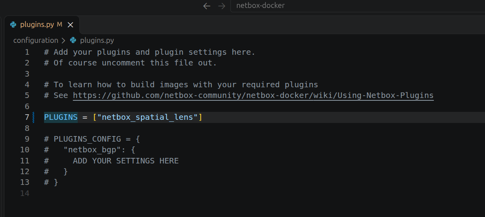

# Installing the Spatial Lens Plugin on NetBox

This document describes how to install and configure the Spatial Lens plugin on NetBox using Docker.

## 1. Installing NetBox

Previously, I was running a version of NetBox older than 4.3.0. Since the Spatial Lens plugin requires NetBox 4.7.x, I needed to install a compatible version of NetBox.

To do so, I used the official [NetBox Docker repository](https://github.com/netbox-community/netbox-docker) and executed the following commands:

```bash
git clone -b release https://github.com/netbox-community/netbox-docker.git
cd netbox-docker

# Copy the example override file
cp docker-compose.override.yml.example docker-compose.override.yml

# Read and edit the file to your liking
docker compose pull
docker compose up
```

I waited until all the Docker containers were initialized and NetBox was running correctly.

Alternatively, Docker Compose can be executed in detached mode:

```bash
sudo docker compose up -d
```

However, I preferred to run it in the foreground to monitor the logs and identify any potential errors during initialization.

## 2. Installing the Spatial Lens Plugin

I followed the installation instructions provided in the official [NetBox Spatial Lens repository](https://github.com/antoinekh/netbox-spatial-lens/tree/master#getting-started).

The standard installation command is:

```bash
pip install netbox-spatial-lens
```

However, since I was using a Docker-based installation of NetBox, I installed the plugin inside both the `netbox` and `netbox-worker` containers using `uv`.

```bash
# Install the plugin in the NetBox container
sudo docker compose exec -u root netbox /usr/local/bin/uv pip install netbox-spatial-lens

# Install the plugin in the NetBox worker container
sudo docker compose exec -u root netbox-worker /usr/local/bin/uv pip install netbox-spatial-lens
```

## 3. Enabling the Spatial Lens Plugin

After installing the plugin in both containers, I modified the following configuration file:

```text
configuration/plugins.py
```

I added `netbox_spatial_lens` to the `PLUGINS` list:

```python
PLUGINS = ["netbox_spatial_lens"]
```

The configuration file should look as shown in the following figure:



*Figure 1. Enabling the Spatial Lens plugin in the `plugins.py` configuration file.*

Save the configuration file before proceeding to the next step.

## 4. Restarting NetBox

After enabling the plugin, I restarted both Docker containers to apply the configuration changes:

```bash
sudo docker compose restart netbox netbox-worker
```

The official Spatial Lens installation instructions also require database migrations.

To monitor the logs after restarting the containers, use:

```bash
sudo docker compose logs -f netbox netbox-worker
```

## 5. Important Considerations

The plugin is installed directly inside the running Docker containers. Therefore, if the containers are removed or recreated, the plugin may need to be installed again. 

For a permanent installation, it is recommended to include the Spatial Lens plugin in a custom Docker image (See [# Solution](#solution) at the end).

## 6. Troubleshooting

During the installation process, I encountered the following error when loading the `/etc/netbox/config/plugins.py` configuration file in one of the NetBox containers:

```text
Traceback (most recent call last):
  ...
KeyError: 'rqworker'

During handling of the above exception, another exception occurred:
  ...
ModuleNotFoundError: No module named 'netbox_spatial_lens'
  ...
django.core.exceptions.ImproperlyConfigured:
Unable to import plugin netbox_spatial_lens
```

<details>
<summary>Click to view the complete traceback</summary>

```text
Traceback (most recent call last):
netbox-worker-1  |   File "/opt/netbox/venv/lib/python3.14/site-packages/django/core/management/__init__.py", line 256, in fetch_command
netbox-worker-1  |     app_name = commands[subcommand]
netbox-worker-1  |                ~~~~~~~~^^^^^^^^^^^^
netbox-worker-1  | KeyError: 'rqworker'
netbox-worker-1  |
netbox-worker-1  | During handling of the above exception, another exception occurred:
netbox-worker-1  |
netbox-worker-1  | Traceback (most recent call last):
netbox-worker-1  |   File "/opt/netbox/netbox/netbox/settings.py", line 968, in <module>
netbox-worker-1  |     plugin = importlib.import_module(plugin_name)
netbox-worker-1  |   File "/usr/lib/python3.14/importlib/__init__.py", line 88, in import_module
netbox-worker-1  |     return _bootstrap._gcd_import(name[level:], package, level)
netbox-worker-1  |            ~~~~~~~~~~~~~~~~~~~~~~^^^^^^^^^^^^^^^^^^^^^^^^^^^^^^
netbox-worker-1  |   File "<frozen importlib._bootstrap>", line 1406, in _gcd_import
netbox-worker-1  |   File "<frozen importlib._bootstrap>", line 1371, in _find_and_load
netbox-worker-1  |   File "<frozen importlib._bootstrap>", line 1335, in _find_and_load_unlocked
netbox-worker-1  | ModuleNotFoundError: No module named 'netbox_spatial_lens'
netbox-worker-1  |
netbox-worker-1  | During handling of the above exception, another exception occurred:
netbox-worker-1  |
netbox-worker-1  | Traceback (most recent call last):
netbox-worker-1  |   File "/opt/netbox/netbox/manage.py", line 10, in <module>
netbox-worker-1  |     execute_from_command_line(sys.argv)
netbox-worker-1  |     ~~~~~~~~~~~~~~~~~~~~~~~~~^^^^^^^^^^
netbox-worker-1  |   File "/opt/netbox/venv/lib/python3.14/site-packages/django/core/management/__init__.py", line 443, in execute_from_command_line
netbox-worker-1  |     utility.execute()
netbox-worker-1  |     ~~~~~~~~~~~~~~~^^
netbox-worker-1  |   File "/opt/netbox/venv/lib/python3.14/site-packages/django/core/management/__init__.py", line 437, in execute
netbox-worker-1  |     self.fetch_command(subcommand).run_from_argv(self.argv)
netbox-worker-1  |     ~~~~~~~~~~~~~~~~~~^^^^^^^^^^^^
netbox-worker-1  |   File "/opt/netbox/venv/lib/python3.14/site-packages/django/core/management/__init__.py", line 263, in fetch_command
netbox-worker-1  |     settings.INSTALLED_APPS
netbox-worker-1  |   File "/opt/netbox/venv/lib/python3.14/site-packages/django/conf/__init__.py", line 122, in __getattr__
netbox-worker-1  |     self._setup(name)
netbox-worker-1  |     ~~~~~~~~~~~^^^^^^
netbox-worker-1  |   File "/opt/netbox/venv/lib/python3.14/site-packages/django/conf/__init__.py", line 109, in _setup
netbox-worker-1  |     self._wrapped = Settings(settings_module)
netbox-worker-1  |                     ~~~~~~~~^^^^^^^^^^^^^^^^^
netbox-worker-1  |   File "/opt/netbox/venv/lib/python3.14/site-packages/django/conf/__init__.py", line 253, in __init__
netbox-worker-1  |     mod = importlib.import_module(self.SETTINGS_MODULE)
netbox-worker-1  |   File "/usr/lib/python3.14/importlib/__init__.py", line 88, in import_module
netbox-worker-1  |     return _bootstrap._gcd_import(name[level:], package, level)
netbox-worker-1  |            ~~~~~~~~~~~~~~~~~~~~~~^^^^^^^^^^^^^^^^^^^^^^^^^^^^^^
netbox-worker-1  |   File "<frozen importlib._bootstrap>", line 1406, in _gcd_import
netbox-worker-1  |   File "<frozen importlib._bootstrap>", line 1371, in _find_and_load
netbox-worker-1  |   File "<frozen importlib._bootstrap>", line 1342, in _find_and_load_unlocked
netbox-worker-1  |   File "<frozen importlib._bootstrap>", line 938, in _load_unlocked
netbox-worker-1  |   File "<frozen importlib._bootstrap_external>", line 759, in exec_module
netbox-worker-1  |   File "<frozen importlib._bootstrap>", line 491, in _call_with_frames_removed
netbox-worker-1  |   File "/opt/netbox/netbox/netbox/settings.py", line 971, in <module>
netbox-worker-1  |     raise ImproperlyConfigured(
netbox-worker-1  |     ...<2 lines>...
netbox-worker-1  |     )
netbox-worker-1  | django.core.exceptions.ImproperlyConfigured: Unable to import plugin netb
```

*Note: The original traceback is truncated on its final line.*

</details>

### Solution

The error occurred because the Spatial Lens plugin was not installed in one of the containers, either `netbox-worker` or `netbox`. I do not remember which one was initially missing the plugin.

This is why I included both installation commands in Section 2, as the plugin should be installed in both containers.

The AI suggested building a custom netbox:latest-plugins image (with a [Dockerfile-Plugins](https://github.com/netbox-community/netbox-docker/wiki/Using-Netbox-Plugins)) to install the netbox-spatial-lens plugin. I did not use that approach.

## References

- [NetBox Docker](https://github.com/netbox-community/netbox-docker)
- [NetBox Spatial Lens](https://github.com/antoinekh/netbox-spatial-lens)
- [Using NetBox Plugins with Docker](https://github.com/netbox-community/netbox-docker/wiki/Using-Netbox-Plugins)